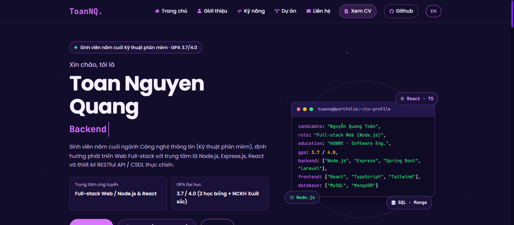

<h2 align="center">
  Portfolio Website — Toan Nguyen Quang 
  <a href="https://quangtoan-dev.vercel.app/" target="_blank">quangtoan-dev.vercel.app</a>
</h2>

  

 

 &nbsp;
 &nbsp;
 &nbsp;
 &nbsp;

<h3 align="center">
    🔹
    <a href="https://github.com/QT-Tech410/portfolio/issues">Report Bug</a> &nbsp; &nbsp;
    🔹
    <a href="https://github.com/QT-Tech410/portfolio/issues">Request Feature</a>
</h3>

## TL;DR

You can fork this repo to modify and make changes of your own. Please give proper credit by linking back to [QT-Tech410](https://github.com/QT-Tech410/portfolio). Thanks!

## Built With

Personal portfolio of **Toan Nguyen Quang (Nguyễn Quang Toàn)** — Final-year Software Engineering student (GPA 3.7/4.0) & **Full-stack Web Developer (Node.js & React)**. This website showcases my featured software projects, technical skillset, academic achievements, and resume. 

This project was built using these technologies:

- **React 18**
- **Vite 5**
- **Bootstrap 5 & Custom CSS3** (Dark Cosmic Theme)
- **React Icons**
- **Vitest & React Testing Library**
- **Visual Studio Code**
- **Vercel**

## Features

**📖 Complete One-Page Developer Portfolio** (Home, About & Education, Professional Skillset & Tools, Featured Projects with Modal Inspector, and Contact)

**🌐 Bilingual Support (VI / EN)** with instant language switching and `localStorage` persistence

**🎨 Dark Cosmic Theme & Developer Terminal UI** styled with CSS custom properties (`src/App.css`) and WCAG AA high-contrast tokens

**📱 Fully Responsive** across mobile (`375px`), tablet (`768px`), and desktop (`1440px`) viewports

**📄 Direct CV & Project Repository Access** linking directly to live GitHub repositories (`ChatApp`, `Banh My King`, `Sports Booking`, `DriverSafeIoT`) and official PDF Resume

## Getting Started

Clone down this repository. You will need `node.js` and `git` installed globally on your machine.

## 🛠 Installation and Setup Instructions

1. Installation: `npm install`

2. In the project directory, you can run: `npm run dev`

Runs the app in the development mode.\
Open [http://localhost:5173](http://localhost:5173) to view it in the browser.
The page will reload if you make edits.

3. Run unit tests: `npm test`

4. Build for production: `npm run build`

## Usage Instructions

Open the project folder and navigate to `/src/config/` and `/src/components/`. 
All personal profile data, bilingual translations, and project entries are centralized in `/src/config/` (`contact.js`, `projects.js`, `i18n.jsx`) so you can update your information in one place without touching component logic.

### Show your support

Give a ⭐ if you like this website!

---

  Designed & Built by <a href="https://github.com/QT-Tech410">Toan Nguyen Quang (QT-Tech410)</a> · Live at <a href="https://quangtoan-dev.vercel.app/">quangtoan-dev.vercel.app</a>

